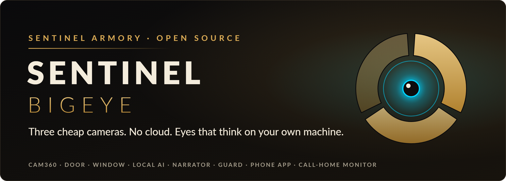
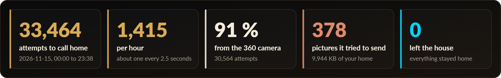
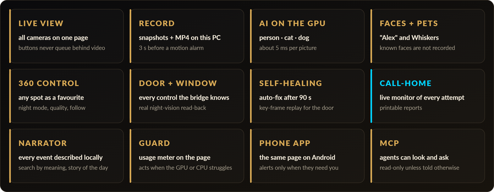
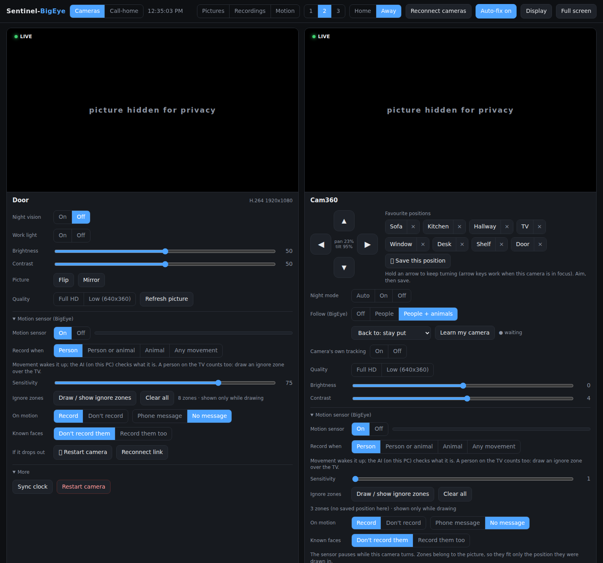
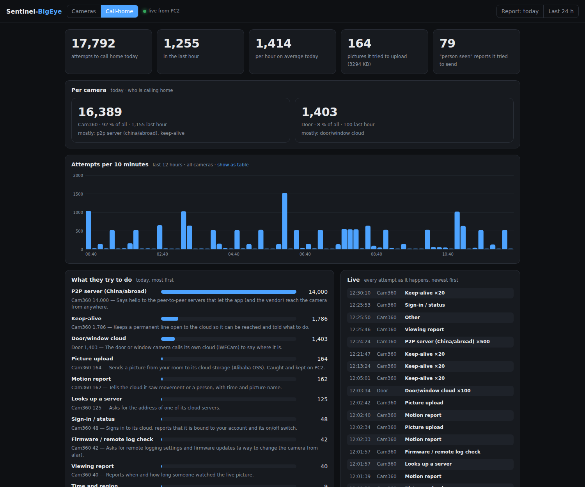
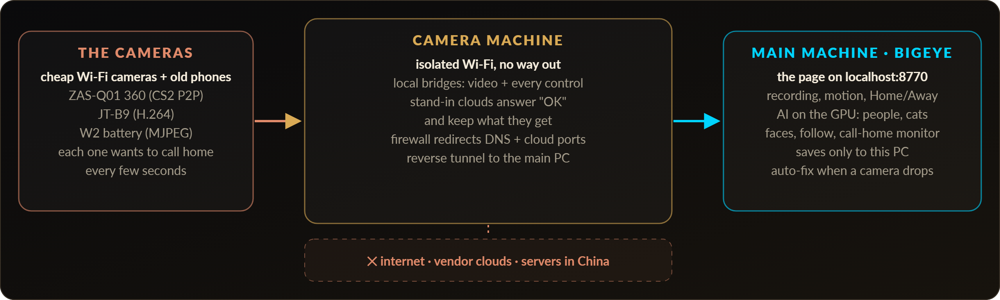

  

  
  
  
  
  

<b>Cheap Wi-Fi cameras want to phone home every few seconds. BigEye keeps them inside your house and gives them a brain of their own.</b>

If you bought a cheap pan/tilt or battery camera that only works through the vendor's app and cloud, BigEye
puts it on a Wi-Fi with no way out, answers its cloud calls locally, and gives you one page in your browser
with live view, recording, motion and person detection, face and pet names, and a live count of every attempt
the cameras make to reach their vendor.

| | |
|---|---|
| 🧭 **Fits your setup?** | [Is this for you](#is-this-for-you) |
| ⚡ **Install** | [docs/setup.md](docs/setup.md), step by step, with a check after each step |
| 🔍 **What it found** | [How they phone home](docs/how-they-phone-home.md): three cameras, 33,000+ attempts in one day |
| 🗺️ **Status** | [Honest status](#honest-status) |

> **Not affiliated with Tange, iCam365, iWFCam, Temu or Alibaba.** All trademarks belong to their owners. No vendor
> software, firmware or keys are included. BigEye talks to cameras you own over your own network.
> Use at your own risk.

  
   One real home, 2026-11-15, a whole day with all three cameras. Counted by BigEye's stand-in clouds.

## Is this for you?

- [ ] You have one of the [tested cameras](#cameras) (or a close relative) and do not want it talking to the vendor.
- [ ] You have a **Linux machine with a Wi-Fi card** that can host a hotspot for the cameras (an old PC is fine).
- [ ] You are comfortable with `systemd --user`, `nftables` and editing one settings file.
- [ ] *(Optional)* an NVIDIA GPU for fast detection; a modern CPU works too (about 125 ms a picture instead of 5).

## What it does

| | |
|---|---|
| **Live view** | all cameras on one page; one request per picture, so buttons never wait behind video |
| **Record** | snapshots and H.264 MP4 on your own disk; motion clips start 3 s before the alarm |
| **Motion + AI** | a light motion sensor wakes a YOLO11 detector: person, cat, dog; ignore zones (per 360 position) |
| **Faces and pets** | known faces get their name and are not recorded; strangers are; your cat gets its name |
| **360 control** | absolute positions (save any spot), real night mode, quality, BigEye follow that learns your mounting |
| **Self-healing** | auto-reconnect after 90 s without picture, "Reconnect cameras", Home / Away |
| **Call-home monitor** | a live tab that counts and explains every attempt to reach the vendor clouds, with printable reports |
| **Privacy masks** | draw free-hand or boxes; masked areas are black in the live view, recordings *and* what the AI sees |
| **Narrator** *(optional)* | a small local vision model in [LM Studio](https://lmstudio.ai) writes one line per event; search events by meaning and get a written story of the day |
| **Automation** | night vision by sunrise/sunset, auto quality, auto Home/Away, a daily timelapse |
| **Guard** | a usage meter on the page; unloads models, slows or restarts the AI when the machine struggles, and tells you what it did |
| **Phone app** *(Android)* | the same page in an app, plus alerts only when they need you; paired with a one-time code, no cloud push ([docs/phone-app.md](docs/phone-app.md)) |
| **MCP server** | AI agents can look at the cameras, events and day story; the few tools that change anything say so ([mcp/](mcp/)) |

   
  <i>The camera page (pictures blanked for this screenshot).</i>

   
  <i>The call-home tab, live.</i>

## How it works

1. **A camera Wi-Fi with no way out.** The camera machine hosts a hotspot; `nftables` drops everything that would leave it.
2. **Stand-in clouds.** The cameras' DNS, cloud and peer-to-peer ports are redirected to small local services that answer
   like the vendor's cloud and keep what they receive (`camera-machine/`).
3. **Local bridges.** They speak each camera's own LAN protocol and offer video plus every control over plain HTTP (`bridges/`).
4. **The page.** `viewer/bigeye-view.py` turns the streams into pictures, records, and loads add-ons
   (`viewer/addons/`: motion, AI, follow, narrator, auto, guard). `ai/bigeye-ai.py` runs detection and faces on your GPU.
5. **Your phone, not the cameras, gets out.** An optional second listener answers only paired phones, at home or
   through your own VPN (`android/`).

The camera machine and the main machine can be the same box. Details: [docs/architecture.md](docs/architecture.md).

## Cameras

| Camera | Status |
|---|---|
| 360 pan/tilt, iCam365 / Tange app (tested: ZAS-Q01) | ✅ video, PTZ, night, quality, tracking, call-home stand-in |
| iWFCam door camera, H.264 (tested: JT-B9 type) | 🔧 bridge being rewritten for this repo ([why](bridges/iwfcam/README.md)) |
| iWFCam W2 battery camera, MJPEG | 🔧 same bridge |

The vendors' "4K" labels did not hold on the tested units: the real streams top out at 1920x1080.

## Honest status

| | |
|---|---|
| ✅ **Works** | live view, recording, motion + AI with zones and masks, faces, 360 control and follow, stand-in clouds, call-home monitor, reports, narrator and search, automation, guard, MCP server, tests for the camera-free parts |
| 🟡 **New** | the Android app (pairing, page and alert long-poll tested; first real-phone run in progress) |
| 🔧 **In progress** | a new iWFCam (door/window) bridge written from our own protocol notes |
| ⚪ **Limits** | the stand-ins need one relay run (iWFCam) or the camera's ID (360) to answer; the 360 must be paired once with the vendor app; after a factory reset an iWFCam camera gets a new LAN token (see the bridge notes) |
| 🔜 **Next** | one-command installer, Home Assistant events |

## License and credits

BigEye is licensed under the **GNU AGPL-3.0** ([LICENSE](LICENSE)): use it, change it, share it; if you run a changed
version as a service, share your changes too.

- Detection: [Ultralytics YOLO11](https://github.com/ultralytics/ultralytics) (AGPL-3.0). Export the model yourself
  (see setup); the weights are not in this repo.
- Faces: [InsightFace](https://github.com/deepinsight/insightface) `buffalo_l`, downloaded at first use;
  **its pretrained models are for non-commercial research use only.**
- 360 camera command ids: the public notes in [jphein/eyeplus-icam365-camera](https://github.com/jphein/eyeplus-icam365-camera)
  helped decode them; the bridge here is our own code.
- RTSP: [bluenviron/gortsplib](https://github.com/bluenviron/gortsplib) (MIT) · GPU runtime: [onnxruntime](https://github.com/microsoft/onnxruntime) (MIT).
- Narrator (optional): runs any vision and embedding model you load in LM Studio (tested with Gemma and EmbeddingGemma);
  no model is included, and each model's own licence applies.

Part of <a href="https://github.com/sentinelarmory">Sentinel Armory</a>: small, sharp tools that keep a home rig in line.
