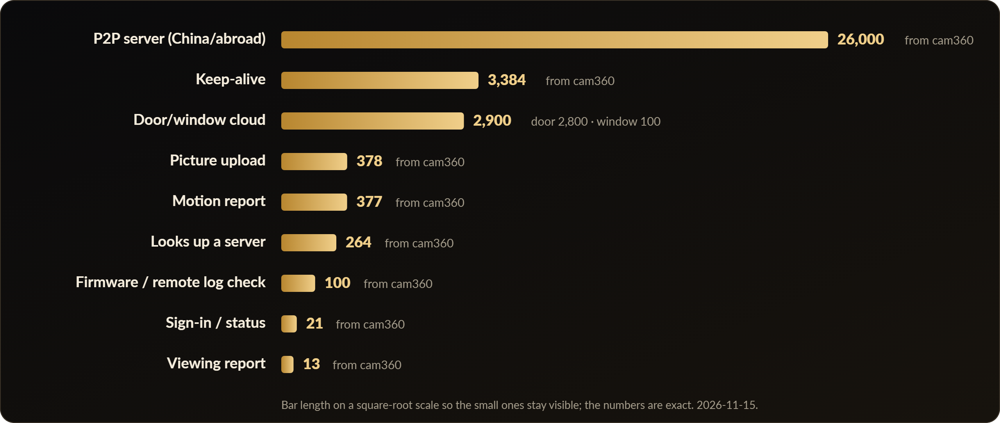
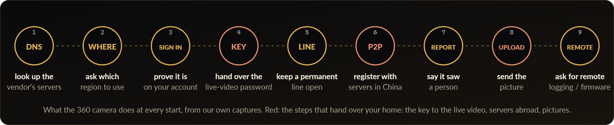

# How cheap cameras phone home

What one home's three cameras tried to do in one day (2026-11-15, local midnight to 23:38), counted by
BigEye's stand-in clouds. Nothing of it left the house.

| | |
|---|---|
| Attempts to call home | **33,464**, about one every 2.5 seconds |
| From the 360 camera | 91 % (door 8 %, window 100 attempts after it came online late in the evening) |
| Pictures it tried to upload | 378 (9.9 MB), with people in them |
| "Person seen" reports | 156 |

The first morning we counted (2026-11-14, to 11:52) gave the same rate: 17,077 attempts. This is what the
cameras do all the time, not a burst. Raw numbers: [`../data/`](../data/).

## The pattern

At every start the 360 camera:

1. **Looks up the vendor's servers**, also through a hard-coded HTTP DNS service that bypasses your own DNS.
2. **Asks which region to use** and gets the addresses of its sign-in, API and statistics servers.
3. **Signs in** and proves it is bound to the owner's account; the account id goes with every later report.
4. **Hands the key to its live video to the cloud.** Whoever holds the cloud can watch.
5. **Keeps a permanent line open**, so the cloud can push new orders at any time.
6. **Registers with peer-to-peer servers abroad** that let the app, and the vendor, reach it from anywhere.
7. **Reports what its own AI saw** ("person", "motion"), **asks for storage keys and uploads the picture.**
8. **Reports when someone watches**, and **asks for remote logging and firmware settings.**

The door and window cameras do the same on their own cloud protocol: they look themselves up and report where they are.

## What BigEye does about it

- The camera Wi-Fi has **no way out**; the firewall drops everything that would leave.
- The cameras' DNS and cloud ports go to **local stand-ins** that answer like the vendor's cloud, hand out dummy keys and
  keep the pictures on your own machine.
- The **Call-home tab** shows every attempt live, explains it, and makes a printable report.

Packet-level details of how the live-video key is handed over are deliberately left out of this public write-up.
